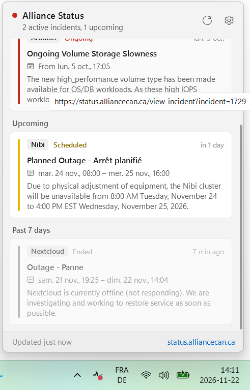
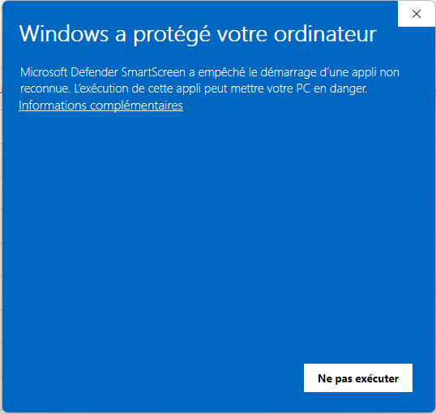
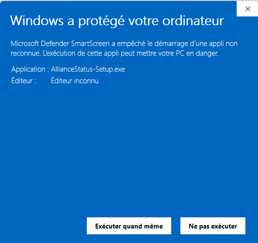
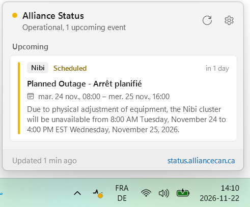
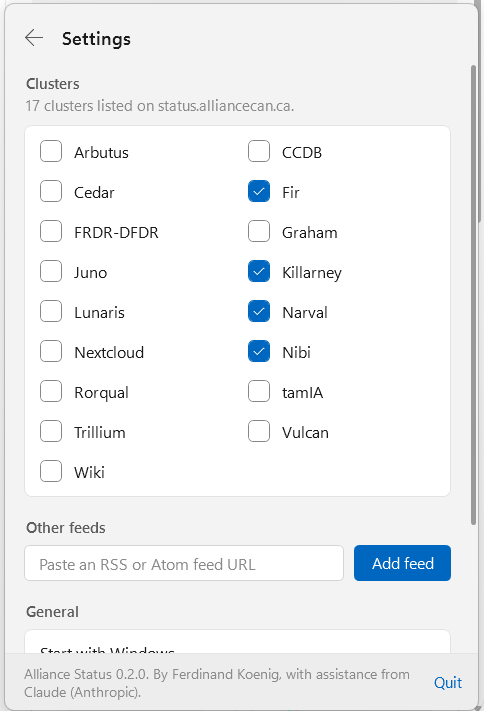

# Alliance Status

A small Windows notification-area app that watches the status feeds of
[Digital Research Alliance of Canada](https://status.alliancecan.ca/) clusters and tells you
when something breaks, is scheduled, or gets fixed.

- Lives in the notification area; left-click opens a compact flyout, right-click opens a menu.
- Active and upcoming incidents first, sorted by date. Finished incidents are greyed out and kept for 7 days.
- Native Windows toasts for new, updated and resolved incidents. Selecting a toast opens the incident.
- Checks at startup, every 30 minutes, after waking from sleep, and when the network comes back
  (every 5 minutes while a feed is failing).
- Follows Windows light/dark mode and accent color; Windows 11 rounded corners.
- Optional start with Windows. No accounts, no cloud, no telemetry.



## Colors

| Color | Meaning |
|---|---|
| 🔴 Red | Ongoing: the outage or maintenance is happening now |
| 🟡 Yellow | Upcoming: scheduled for the future |
| ⚪ Grey | Past: finished within the last 7 days |

The **tray icon** shows a dot with the overall status of the clusters you selected:

| Dot | Meaning |
|---|---|
| 🟢 Green | All selected clusters are up (past incidents don't count) |
| 🟡 Yellow | Something is scheduled |
| 🔴 Red | Something is ongoing |
| ⚪ Grey | A feed can't be reached right now |

For Alliance feeds, the outage window comes from the feed itself: each entry's publication date is
the start and its update date is the end. The app doesn't try to tell planned from unplanned outages,
because the feed has no field for that.

## Credits

Written by **Claude** (Anthropic's AI model, Claude Opus 5.5), initiated and co-developed by
**Ferdinand Koenig**.

## Install

**Option A: automated GitHub builds (recommended).** Push this folder to GitHub. To create a release:

1. Test locally: `.\Install.cmd` or `dotnet run --project src\AllianceStatus`
2. Push a tag: `git tag v1.0.0 && git push --tags`
3. The workflow automatically builds and publishes a Release

Download `AllianceStatus-Setup.exe` from the Release and double-click it.

### Installation steps

1. Double-click `AllianceStatus-Setup.exe`.

2. **Windows SmartScreen warning** (normal for unsigned apps):
   - Click **Informations complémentaires** (or **More info** on English Windows).

     

   - Then click **Exécuter quand même** (or **Run anyway**).

     

3. The installer opens and asks:
   - Install location (defaults to `%LOCALAPPDATA%\Programs\AllianceStatus`)
   - Whether to start with Windows (optional)

4. Done. The app opens and sits in the notification area (bottom-right of the taskbar).

   

No admin rights needed. Uninstall from Settings → Apps → Alliance Status.

**Option B: double-click `Install.cmd`.** Builds and installs on your own PC. If the .NET 10 SDK
isn't installed, it downloads a temporary private copy (about 200 MB) and deletes it afterwards.
Same per-user install with a Settings → Apps entry.

**Option C: unzip and run.** Unzip `AllianceStatus-win-x64-standalone.zip` and run `AllianceStatus.exe`
directly from anywhere (USB stick, custom folder, etc.). No installer, no Start menu entry.

**Local build:** `.\publish.ps1 -Mode standalone`, then `ISCC.exe installer\AllianceStatus.iss`
([Inno Setup 6](https://jrsoftware.org/isinfo.php), free).

### Updates

The app checks GitHub once a day. When a new version is out, you get one notification, and a
blue dot appears on the gear icon. Open **Settings** to find the **Download** button. Install the
new version over the old one; your clusters and settings are kept.

## Requirements

| To run | Windows 10 1809+ or Windows 11 (x64 or ARM64) |
|---|---|
| To build | [.NET 10 SDK](https://dotnet.microsoft.com/download/dotnet/10.0) |

The only third-party dependency is `Microsoft.Toolkit.Uwp.Notifications` (MIT, from NuGet),
which provides native toasts and click handling for unpackaged desktop apps.

## Build and run

```powershell
dotnet run --project src\AllianceStatus
```

Run the tests:

```powershell
dotnet test
```

Visual Studio 2022 17.14+ (or Rider) can open `AllianceStatus.sln` directly.

## Package as a Windows executable

```powershell
.\publish.ps1                     # both variants, x64
.\publish.ps1 -Mode standalone    # one variant
.\publish.ps1 -Runtime win-arm64
```

Output goes to `dist\`:

| Variant | File | Notes |
|---|---|---|
| `framework` | `dist\win-x64-framework\AllianceStatus.exe` | A few MB; needs the .NET 10 Desktop Runtime |
| `standalone` | `dist\win-x64-standalone\AllianceStatus.exe` | Larger; runs on any supported PC with nothing installed |

Each variant is also zipped. Copy the exe anywhere (for example `%LOCALAPPDATA%\Programs\AllianceStatus\`)
and run it. If you move it later, the next launch updates the autostart entry automatically.

The equivalent manual command is:

```powershell
dotnet publish src\AllianceStatus -c Release -r win-x64 --self-contained true `
  -p:PublishSingleFile=true -p:IncludeNativeLibrariesForSelfExtract=true -p:EnableCompressionInSingleFile=true
```

## Using it

- **Left-click** the tray icon to open or close the overview. Press Esc or click elsewhere to close it.
- **Right-click** for Open, Refresh now, Start with Windows, Open status website, Quit.
- The tray icon badge is **red** for an active incident, **amber** for scheduled maintenance,
  **grey** when a feed can't be reached, and absent when everything is fine.
- **Settings** (gear icon) lists the clusters found on status.alliancecan.ca. Tick the ones you care about.
  Nibi is selected by default. You can also paste any other RSS or Atom feed URL.
- Launching the exe again while it is running simply opens the overview.

### Settings



- **Clusters:** tick which Alliance clusters you want to monitor. The list is refreshed daily from status.alliancecan.ca.
- **Other feeds:** paste any RSS or Atom feed URL to add it. Remove feeds by clicking the trash icon.
- **General:** "Start with Windows" runs the app minimized when you sign in.

#### Change the version number

The version displayed in Settings ("Alliance Status 1.0.0") comes from `src/AllianceStatus/AllianceStatus.csproj`:

```xml
<Version>1.0.0</Version>
```

Change this line to `1.1.0` or any version you want, then rebuild or publish. The new version appears in the Settings footer.

Command-line switches:

| Switch | Effect |
|---|---|
| `--minimized` | Start without opening the overview (used by autostart) |
| `--cleanup` | Remove the autostart entry and toast registration, then exit (run before deleting the app) |

## Where data lives

Everything is in `%LOCALAPPDATA%\AllianceStatus\`:

- `state.json` holds subscriptions, cached cluster list, incident history, feed health and the record of
  which notifications were already shown. It is written atomically; if it is ever corrupted it is set aside
  as `state.json.corrupt-*` and the app starts fresh.
- `log.txt` is a small, size-capped log of fetch errors and repairs.

Autostart uses the per-user `HKCU\…\CurrentVersion\Run` key, so no admin rights are needed.

To uninstall: right-click → Quit, run `AllianceStatus.exe --cleanup`, then delete the exe and the data folder.

## How it works

```
src/AllianceStatus
├─ App.xaml(.cs)            startup, single instance, tray wiring, toast activation, shared Win11 styles
├─ Feeds/
│  ├─ LooseDate.cs          tolerant RFC 822 / ISO 8601 / Alliance date parser
│  ├─ FeedParser.cs         RSS 0.9x/1.0/2.0 + Atom, with repair and salvage for broken XML
│  ├─ FeedClient.cs         shared HttpClient, timeouts, retries, offline detection
│  └─ Alliance.cs           feed URL scheme and cluster discovery
├─ Services/
│  ├─ StatusMonitor.cs      polling, merge, pruning, notification decisions
│  ├─ IncidentRules.cs      active / upcoming / past classification
│  ├─ Notifier.cs           Windows toasts
│  ├─ TrayIcon.cs           notification-area icon (drawn at runtime) and themed menu
│  ├─ ThemeManager.cs       light/dark + accent color as live brushes
│  └─ StateStore.cs, Autostart.cs, Log.cs, …
└─ Views/FlyoutWindow.xaml  overview and settings
```

**Technology.** .NET 10 + WPF. WPF gives a light, dependency-free native UI; the WinForms `NotifyIcon` is used
only for the tray icon because WPF has none. The window is created when opened and destroyed when closed,
so the idle app is just a timer, the tray icon and a small JSON state.

**Dates.** The Alliance feed uses non-standard timestamps such as `2026-11-20 21:42:26+00:00` and
`2026-11-24 13:00`. `LooseDate` tries ISO-like forms, then RFC 822 (ignoring wrong weekday names and
understanding zone names like `EST`), then .NET's parser, then any ISO date embedded in the text.
Timestamps without a zone are taken as **UTC**, matching the explicit `+00:00` the feed uses elsewhere
(change `LooseDate.AssumedOffset` if that ever proves wrong). All times are shown in your local time zone.

**Malformed feeds.** The parser first tries strict XML. If that fails it repairs the text (bare `&`,
HTML entities like `&nbsp;`, control characters, DOCTYPE) and tries again. If it still fails it salvages
each `<item>`/`<entry>` on its own. An HTML error page is reported as an error rather than read as "no incidents".

**Classifying incidents.** Feeds rarely say whether an incident is over, so `IncidentRules` combines:
explicit start/end fields, or schedules written in the text ("Start: …", "from … to …", "13:00 – 17:00");
wording such as *resolved*, *completed*, *restored*, *cancelled* in the status, title or first lines
(but not "not resolved" or "will be completed"); the entry disappearing from the feed; and, for open-ended
entries, 14 days without activity. An entry with a future start is **upcoming**; one whose end has passed
or that reads as resolved is **past**.

**No duplicate notifications.** For every incident the app stores a fingerprint of its title, text, status
and schedule, plus the state at the time. A toast is shown only when an incident is new (and not already over),
when its content changes, or when it becomes resolved. Timestamps that feeds regenerate on every request
are deliberately left out of the fingerprint. More than three changes in one check collapse into a single
summary toast, so subscribing to a busy cluster never floods you.

**Failures.** A failed fetch never removes or resolves anything; the last known incidents stay on screen and the
footer shows "Offline" or which feeds are unreachable (hover for details). Retries use short back-off
inside a check and a 5-minute retry interval between checks until the feed recovers.

## Troubleshooting

- **No toasts:** check Settings → System → Notifications, and that Do not disturb / Focus is off.
  Toasts appear under the name "Alliance Status".
- **A cluster is missing from the list:** the list comes from the status home page and refreshes daily.
  You can always paste its feed URL (`https://status.alliancecan.ca/system/<Name>/feed.rss`) under Other feeds.
- **Something looks wrong:** see `%LOCALAPPDATA%\AllianceStatus\log.txt`.
